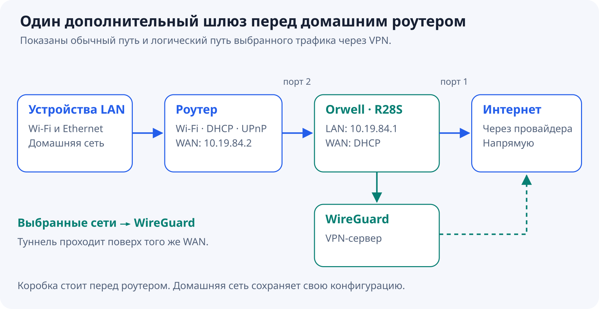
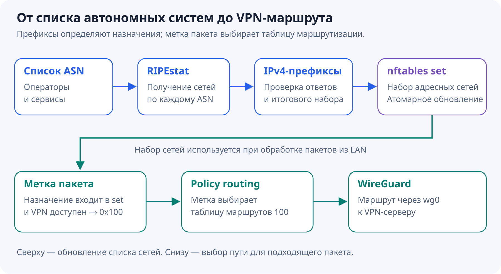
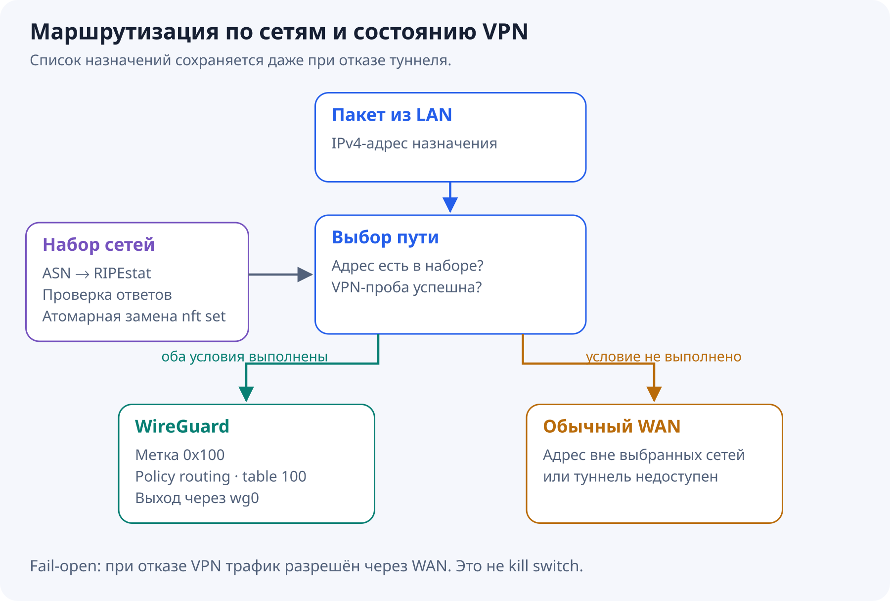
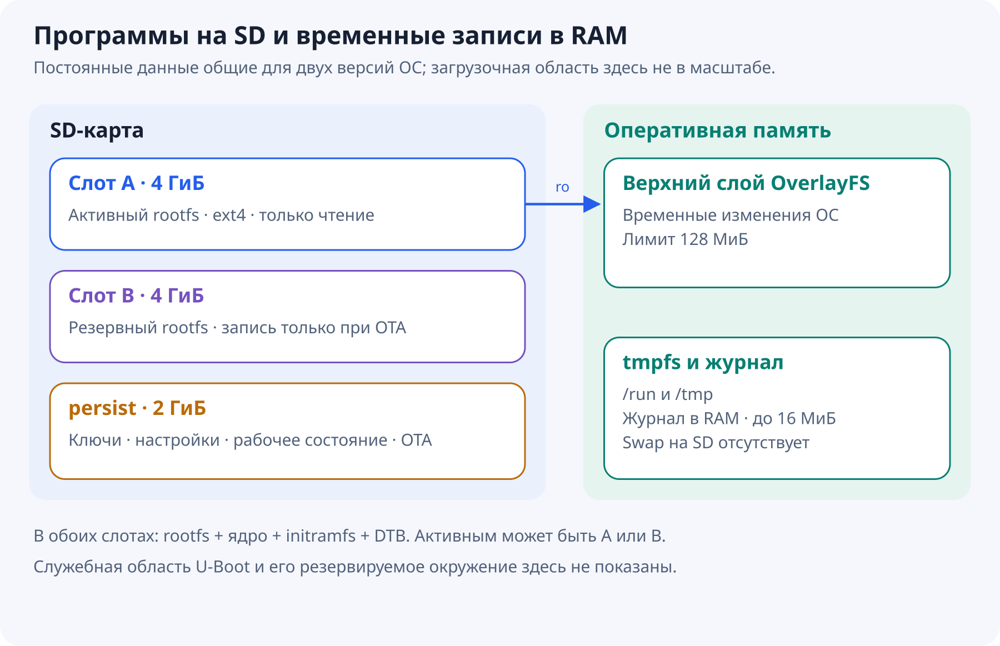
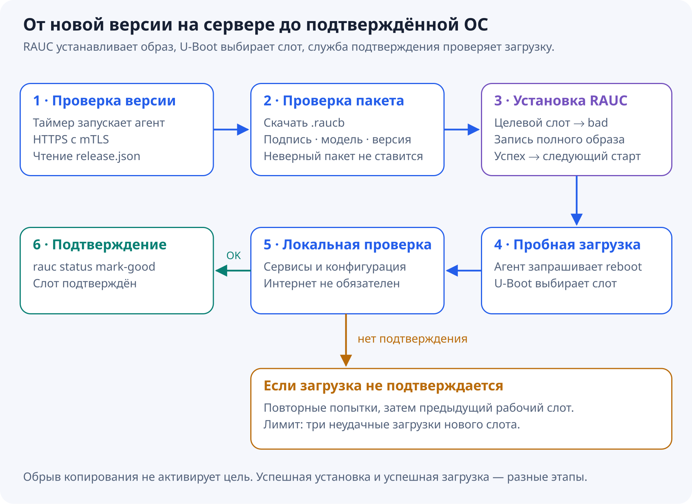

# VPN шлюз на NanoPi R28S с обновлением образами и откатом

Мне хотелось поставить перед домашним роутером небольшую коробку, которая отправляет трафик к выбранным сетям через WireGuard, а остальной выпускает напрямую. Домашний роутер при этом продолжает раздавать Wi-Fi и заниматься домашней сетью.

Маршрутизация оказалась только частью задачи. У такой коробки есть SD-карта, питание иногда пропадает, а после неудачного обновления совсем не хочется ехать за ней с USB–UART. Поэтому постепенно получился шлюз на Debian 13 с системой только для чтения, двумя слотами ОС и подписанными OTA-обновлениями.

## Куда поставить коробку

Железо — NanoPi R28S на RK3528A. Используются SD-карта, два Ethernet-порта и debug-порт для первоначальной отладки. Управление через SSH на плате в этой конфигурации не используется.



Порт 1 — WAN, адрес он получает по DHCP. Порт 2 подключён к WAN домашнего роутера. На этом участке используются адреса `10.19.84.1` у шлюза и `10.19.84.2` у роутера. Подсеть отсылает к «1984», а устройство получило имя Orwell.

У DHCP-сервера ровно один выдаваемый адрес и аренда на пять минут. Привязки к MAC клиента нет: кто подключён ко второму порту, тот и получает адрес. Это удобно при замене роутера. Единственная аренда может удерживаться предыдущим клиентом до истечения её срока; отдельного демона, который сбрасывает её при потере линка, здесь нет.

Wi-Fi, DHCP домашним устройствам и локальный UPnP остаются на домашнем роутере. Чтобы не строить цепочку UPnP-серверов, шлюз передаёт ему новые входящие TCP/UDP-соединения через DNAT с сохранением порта. Для DHCP самой платы и WireGuard endpoint предусмотрены исключения.

Двойной NAT при этом сохраняется. Такая настройка не устраняет CGNAT провайдера и сама по себе не доказывает доступность домашней сети из Интернета. Firewall нижестоящего роутера продолжает определять, какие входящие соединения разрешать.

## Как выбрать трафик для VPN

Выбор сделан по автономным системам, или ASN. Это полезно, когда нужно маршрутизировать сети конкретных операторов и сервисов без поддержки длинного ручного списка адресов.

Конвейер состоит из нескольких обычных механизмов Linux:





Обновлятор получает originating-префиксы заданных AS и проверяет ответы. Новый набор попадает в nftables одной атомарной операцией. Если один из ответов некорректен или итоговый набор пуст, сохраняется предыдущий рабочий набор. Корректный ответ без IPv4-префиксов у отдельной AS не мешает обновлению остальных.

Пакеты LAN к адресам из набора получают метку `0x100`. Для неё настроена отдельная таблица маршрутизации `100`, ведущая в `wg0`. Остальные назначения используют обычный WAN. Префиксы обновляются после загрузки и затем по расписанию каждые шесть часов.

Здесь есть существенное ограничение: ASN — это принадлежность IP-сети, а не точное распознавание приложения. Например, кэш сервиса у стороннего оператора может оказаться вне выбранных AS. Один ASN, наоборот, может содержать много разных сервисов.

### Что происходит при отказе туннеля

Наличие интерфейса WireGuard ещё не означает, что через него проходит трафик. Поэтому отдельный монитор примерно каждые десять секунд проверяет путь контрольным ICMP-запросом через туннель.

Успешная проба разрешает VPN-маркировку на ограниченное время — 30 секунд. Неудачная проба отзывает разрешение. Если сам монитор перестал работать, разрешение истечёт автоматически. Набор префиксов при этом не стирается.

Политика намеренно **fail-open**: при проблемах VPN выбранный трафик уходит через WAN. Это шлюз для доступности, а не kill switch для сокрытия трафика от провайдера. После восстановления пробы выборочная маршрутизация возвращается.

Переключение пути меняет внешний адрес и NAT-состояние. Существующим соединениям может понадобиться переподключение; бесшовного переноса TCP-сессий между WAN и VPN здесь нет.

Ещё один практический выбор — masquerade LAN при выходе в WireGuard. На VPN-сервере каждому шлюзу нужен только собственный туннельный адрес `/32`. Так несколько коробок могут использовать одинаковую транзитную LAN-подсеть, не создавая конфликтов маршрутов на сервере. Ключи и туннельные адреса у устройств, разумеется, должны различаться.

## Какие сервисы работают внутри

В этой реализации нет отдельной универсальной панели управления. Основные функции распределены между компонентами Debian.

| Задача | Компонент |
|---|---|
| Интерфейсы, DHCP-клиент WAN и DHCP-сервер LAN | systemd-networkd |
| NAT, фильтрация и наборы адресов | nftables |
| Туннель | WireGuard |
| DNS платы и транзитной LAN | Unbound |
| Синхронизация часов и NTP для LAN | chrony |
| Запись обновлений и интеграция со слотами | RAUC |
| Периодические проверки | systemd timers |

Unbound использует пул DoT-серверов Cloudflare, Google, Quad9 и Яндекса. Это общий набор кандидатов с учётом доступности и задержек, а не строгая очередь «основной сервер, затем резервный» и не голосование по ответам.

Повторный запрос при действующем TTL обслуживается из кэша. Включён `prefetch`: если клиент запросил запись в последние 10% её TTL, Unbound возвращает ещё действующий ответ и обновляет запись в фоне. Все записи подряд по таймеру не опрашиваются.

Для профиля платы заданы четыре рабочих потока, кэш сообщений 32 МиБ и RRset-кэш 64 МиБ. Это настройки кэшей, а не измеренный предел производительности и не общий лимит памяти процесса. Нагрузочных цифр QPS в этой статье нет.

Если все настроенные DoT-серверы несколько проверок подряд недоступны, отдельный монитор временно переводит Unbound на DNS из WAN DHCP. **Этот аварийный режим использует обычный незашифрованный DNS.** После восстановления DoT защищённый пул возвращается. Unbound при переключении не перезапускается и сохраняет кэш.

DHCP предлагает клиенту DNS и NTP шлюза, но чужие DNS, DoH и DoT не перехватываются и не блокируются. Задачи запрещать исходящие соединения у этой коробки нет.

Chrony получает время от нескольких внешних источников, включая российские, и отвечает на NTP-запросы из LAN. Время здесь важно ещё и для холодного старта TLS: неверные часы могут мешать DoT и скачиванию прошивки. Часть NTP-источников задана числовыми адресами, поэтому для их поиска не требуется уже работающий DNS.

## Зачем системе раздел только для чтения

Обновлять пакеты прямо на SD удобно до первого неудачного обновления или отключения питания. Для этой коробки выбран другой способ эксплуатации: программы обновляются образом, а рабочие данные отделены от ОС.



Разметка содержит служебную область загрузки, два слота rootfs по 4 ГиБ и общий раздел `persist` размером 2 ГиБ. Для готового SD-образа нужна карта от 16 ГБ. В каждом слоте лежат rootfs, ядро Linux, initramfs (небольшая среда для подготовки основной системы при загрузке) и DTB (Device Tree Blob — файл с описанием аппаратуры: процессора, памяти и периферии платы). Эти компоненты переключаются вместе.

При загрузке initramfs монтирует выбранный ext4-rootfs только для чтения. Сверху создаётся OverlayFS с верхним слоем в RAM, чтобы программы могли пользоваться привычными путями файловой системы. Лимит этого слоя — 128 МиБ. Временные каталоги тоже находятся в tmpfs, системный журнал хранится в RAM с лимитом 16 МиБ. Swap на SD не создаётся.

В `persist` остаются данные, которые должны переживать перезапуск: ключ WireGuard, machine-id, учётные записи, настройки сети и сервисов, последний рабочий набор AS-префиксов, состояние chrony и OTA.

Это сокращает фоновую запись, но не делает её нулевой. Меняются настройки и состояние сервисов, обновляется набор префиксов. При OTA пакет сначала скачивается на SD, затем целиком записывается неактивный слот. Количественный выигрыш в записанных байтах ещё нужно измерить.

Есть и цена: временные изменения ОС и локальные журналы теряются при перезагрузке. Для постоянного изменения предусмотренных конфигурационных файлов используется отдельный механизм сохранения. Произвольная правка в RAM не превращается в новую версию прошивки.

## Как собирать и обслуживать образ

Все пакеты и определения служб входят в образ заранее. Первый запуск не должен превращаться в установочный скрипт, которому для окончания работы нужен Интернет.

Одна Ansible-роль умеет настраивать смонтированный rootfs на сборочной машине и уже работающую плату. Для debug-порта сделан отдельный serial-транспорт. На самой плате Ansible controller не нужен.

На A/B-системе установка пакетов через Ansible и фоновые APT-обновления отключены. Программные изменения вносятся в rootfs вне устройства и доставляются новой прошивкой. Настройки, которым положено быть постоянными, сохраняются в `persist`.

Общий образ не содержит уникальных приватных ключей устройства. Отдельный этап персонализации может заранее добавить его WireGuard-идентичность, настройки и клиентский TLS-сертификат. Это позволяет подготовить конкретную SD на ПК, не занимаясь настройкой уникальных данных через UART после включения. Персонализированный образ предназначен для одного устройства: его копирование на разные коробки продублирует TLS- и WireGuard-ключи.

## Как работает обновление A/B

Пока устройство работает из A, обновлятор пишет B, и наоборот. Но двух разделов недостаточно: загрузчик должен знать, можно ли запускать новый слот и что делать, если он не подтвердился.

Для установки используется RAUC из Debian, а для выбора слота — U-Boot с резервируемым окружением. Состояние хранится в переменных `BOOT_ORDER`, `BOOT_A_LEFT` и `BOOT_B_LEFT`. На каждый слот выделено три попытки загрузки.



Установка начинается с исключения целевого слота из загрузки. Затем RAUC записывает туда образ. Только успешное завершение установки делает его следующим кандидатом на запуск. После этого агент запрашивает обычную перезагрузку.

U-Boot уменьшает счётчик попыток **до** запуска ядра. После загрузки отдельная служба проверяет локальную работоспособность: networkd, nftables, Unbound, chrony, LAN-адрес, наличие WireGuard-интерфейса, read-only нижний слой и watchdog. При успехе вызывается `rauc status mark-good`.

Наличие WAN-аренды или исправного VPN для подтверждения не требуется. Иначе сбой провайдера мог бы откатывать исправную ОС.

Если система не подтверждается, происходят повторные загрузки, а после исчерпания трёх попыток выбирается резервный слот. Аппаратный watchdog запускается ещё в U-Boot и затем обслуживается systemd. Служба подтверждения также ограничена по времени, чтобы ожидание работоспособности не растягивалось бесконечно.

Общий `persist` требует дисциплины: новая прошивка не должна при пробной загрузке необратимо менять данные, которые нужны старой. Иначе откат программ сработает, а откатываться им будет уже не к чему.

## Кто сообщает устройству о новой версии

Инициатор — сама коробка. Примерно через 3–4 минуты после старта и затем через 30 минут после предыдущей проверки, со случайной задержкой до минуты, systemd запускает небольшой OTA-агент. Постоянно работающего управляющего агента для этого не требуется.

Сервер хранит подписанный пакет и небольшой индекс:

```json
{"version":"2026101608","bundle":"2026101608.raucb"}
```

Агент сравнивает номер с текущим и последним подтверждённым выпуском. Более старые и равные версии автоматически не устанавливаются. Имя пакета должно соответствовать номеру; индекс не может отправить клиент скачивать произвольный URL.

В штатной схеме сервер — Caddy. У каждого устройства свой клиентский сертификат и соответствующий приватный ключ для HTTPS с mTLS. Сертификаты выпускает общий CA, но приватные ключи между коробками не копируются. Дополнительно Caddy проверяет точное совпадение сертификата с явно допущенными. Для отзыва доступа одной коробки достаточно удалить её сертификат из набора допуска и перечитать конфигурацию сервера — остальные устройства продолжат работать.

Подпись прошивки проверяется отдельно от mTLS. У серверной авторизации и доверия к содержимому разные задачи: разрешение скачать файл не означает разрешения выпустить новую ОС. Приватный ключ подписи не хранится ни на устройстве, ни на сервере раздачи.

Пакеты используют формат RAUC `verity`. Это проверка обновления, а не утверждение, что каждый блок работающего rootfs проверяется dm-verity или что на плате настроен Secure Boot. Сам U-Boot через это OTA не обновляется.

Публикация тоже состоит из двух шагов: сначала загрузить и проверить пакет, затем атомарно заменить индекс. Так устройство не увидит объявление о файле, который ещё не докопировался.

## Где пришлось разбираться с особенностями платы

Значительная часть работы оказалась на границе vendor-загрузчика и обычного Linux.

Для ранней загрузки используется FIT (Flattened Image Tree) — контейнер, объединяющий несколько загрузочных компонентов, их описания и контрольные суммы. Данные внутри него нужно было выровнять по 512 байт. С обычным выравниванием упаковщика SPL останавливался на проверке хеша одного из компонентов. При этом менять сами vendor-компоненты ранней загрузки для решения проблемы не потребовалось.

Другой случай — адрес загрузки DTB, файла с описанием аппаратуры для Linux. U-Boot тоже пользуется таким описанием во время своей работы. Если загрузить файл для Linux в ту же область оперативной памяти, описание самого загрузчика будет затёрто и его дальнейшая работа нарушится. Поэтому для Linux DTB пришлось выделить отдельный адрес.

Были и ошибки уже в initramfs. Из-за приватной `umask` верхний каталог OverlayFS получил права `0700`, а корень унаследовал их: обычные служебные пользователи не могли пройти по `/`. Исправление состояло в явных правах `0755` у верхнего каталога при сохранении строгих прав для секретов.

Отдельно пришлось сохранить MAC-адреса интерфейсов платы при переносе на новую SD. Здесь MAC нужны для устойчивых имён `wan0` и `lan0`; к привязке клиентского роутера они отношения не имеют.
